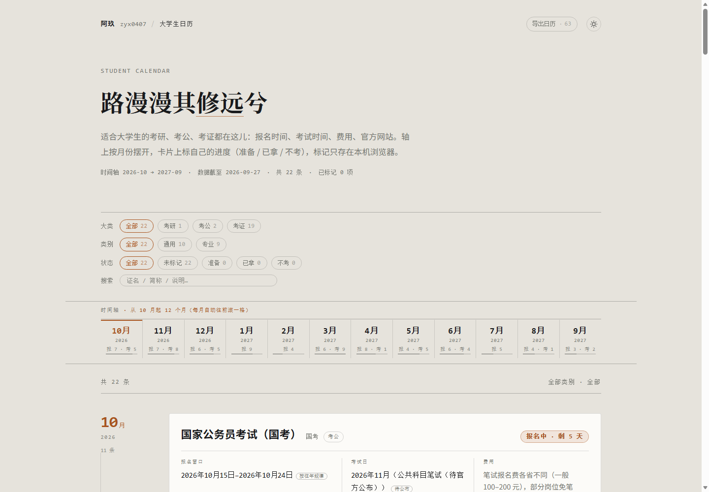

# 大学生日历 · Student Calendar

[English](README.en.md) · 简体中文

**考研 / 考公 / 考证** 的时间轴：22 项证书摆在**从现在起滚动 12 个月**的月份轴上，每项一张卡，卡上是四件事实 —— **官方网站 · 费用 · 报名时间 · 考试时间**；可按大类、类别和自己的状态筛。

在线地址 → <https://work1.zyx0407.com/>
纯静态 · 零依赖 · 零构建 · 零第三方库（连二维码都是自己写的）



## 页面上有什么

- **月份轴**：12 个等宽格子，每格写「报 N · 考 N」——这个月有几项在报名窗口里、有几场考试；当前月一条琥珀线。轴在滚动时会钉在视口顶部，到清单末尾自动松手，不盖页脚。点一格滚到那个月的分组（那个月没安排会落到最近的下一个月，并给一句提示）。
- **卡片**：按月分组，组内先按类别、同类里「最近要有事的」排前面。卡面＝证名 + 简称 + 类别 + 倒计时 → 报名窗口 / 考试日 / 费用 → 官方网站（整行可点，新窗口打开）→ 适合谁 → 一段写给同学的口语提示 → 数据截至 · 状态 · 分享。
- **筛选**：大类（考研 / 考公 / 考证）· 类别（语言 / 计算机 / 财经商科 / 食品与营养 / 教师资格 / 技能新兴 / 出国）· 状态 · 搜索。搜索是两段式：先只匹配证名、简称、类别、官网名，一条都没命中才回落到说明正文，并在列表头标出来。
- **状态标记**：每项可标 准备 / 已拿 / 不考，存在浏览器 `localStorage`（键 `kaozheng.status.v1`），只在本机，不上传任何东西。
- **分享**：每张卡的分享弹层就是一整张成品卡（报名 · 考试 · 费用 · 官网 · 二维码），可存成 2 倍图 PNG，或复制带 `?card=<项>` 的链接 —— 扫开就直接落到那张卡并标亮。
- **导出日历**：右上角「导出日历 · N」把**当前筛选结果 × 时间轴这 12 个月**写成 `.ics`（今天起、到窗口末为止的报名开始 / 报名截止 / 考试，全-day 事件，含官网与数据截至），可直接导进手机日历；按钮上的 N 就是这一下会导出的日程数。
- **手机**：整页按窄屏重排 —— 顶栏收一行、首屏收紧、筛选每排横向滑、时间轴压成 73px 窄条吸顶、卡片改成单列标签值、分享弹层整张可滚。

## 三行上手

双击 `index.html` 就能跑（纯静态，`file://` 也行）。要一个本地端口的话，用任何静态服务器指到这个目录即可，例如：

```powershell
npx serve .
```

## 数据是怎么管的

- **数据与页面分离**：`数据.js` 只装数据（挂在 `window.KAOZHENG` 上，不碰 DOM），`app.js` 只负责渲染与交互 —— 改数据就等于改页面。
- **窗口自动滚动**：`元信息.时间轴起点` 写 `"自动"` 时，页面按当前所在月往后数 12 个月，每月 1 号自己往前滚一格，月底不需要动任何数据；库里已铺到 2029-01。
- **来源口径**：每条都标 `来源`（`官方` / `往年规律`）与 `数据截至`；写「往年规律」必须给备注说明按哪一年推的。
- **不编日期**：官方没公布的确切日期一律 `未公布: true`，日期填去年同期并在备注写「参考 XXXX 年 X 月，待官方公布」。
- **官网只收官方域名**，培训机构站点不进库。

## 二维码是自己写的

`app.js` 里的 `QR` 模块，零依赖：字节模式（UTF-8）+ 纠错等级 M + 版本 1~10，含 BCH(15,5) 格式信息、GF(256) Reed–Solomon（本原多项式 `0x11D`）、8 种掩码按罚分择优。码在点开分享时才生成，22 张卡不会一上来画 22 个码。

## 视觉

与主站同一套：白天＝暖纸、深夜＝深色展厅两态，默认跟随系统、可手动切换并记住；一个强调色（琥珀）只用在当前状态那一处（倒计时徽章、当前月、选中的状态），其余信息靠底色差、字重与字号分层。字型三档 —— 思源宋（标题）· 思源黑（正文）· 仿宋斜（旁白）。

## URL 参数

| 参数 | 作用 |
| --- | --- |
| `?theme=day` / `?theme=night` | 强制某一配色，不写入本地存档 |
| `?cat=语言` | 预筛某个类别 |
| `?card=<项 id>` | 直接滚到那张卡并标亮（分享码里装的就是这个） |
| `?still=1` | 关过渡与动效、直接给终态 |

## 文件

| 文件 | 是什么 |
| --- | --- |
| `index.html` | 单页骨架：顶栏 · 说明行 · 筛选 · 月份轴 · 卡片分组 · 页脚 |
| `数据.js` | 全部证书数据（`window.KAOZHENG`），采集规矩写在文件头 |
| `app.js` | 月份轴 / 卡片渲染 / 筛选 / 状态标记 / 倒计时 / 分享卡 / `QR` 模块 |
| `style.css` | 度量、两套配色、胶囊与悬停规律 |
| `theme.js` | 日夜切换 |
| `CNAME` | 自定义域 `work1.zyx0407.com`（GitHub Pages 靠这个文件认 Host） |

## 说明

- 页面不加载任何第三方脚本、不请求外部资源、不做统计；数据全在前端。
- 考试日期、费用、报名窗口都可能被官方临时调整，**以各考试院官网公告为准**；卡上的「数据截至」标的是每条信息核对到的日期。
- 本仓库未附开源许可证：代码与整理的数据保留所有权利。

## 更新记录

- **v1.2（2026-10-19）**：修「点月份格不跳」（12 格里 4 格点了没反应、其余落点被吸顶条压住）；修吸顶三个 bug（钉住时整页往上窜 128px、早钉 115px、脱开一次后再也不钉）；「官方网站」整行改成真链接并删掉页脚重复的「官网核对」；导出 `.ics` 只导时间轴这 12 个月（此前会把铺到 2029 的日期全灌进去，123 个日程里 60 个在窗外），按钮直接标条数；配色试调一层级（底色与卡面拉开、日期加重、费用与旁白退后、倒计时做成琥珀徽章）。
- **v1.1（2026-10-17）**：手机端整页适配（顶栏 / 首屏 / 筛选 / 吸顶时间轴 / 分组 / 卡片 / 分享弹层）；分享卡与存图重做（宋体标题、纸面版式、长文带省略号、手机不再溢出）；新增「导出日历」`.ics`；左上角「阿玖 zyx0407」可点回主站；页脚显示版本号。
- **v1.0（2026-09-27）**：首次上线，22 项证书 × 12 个月滚动时间轴。
